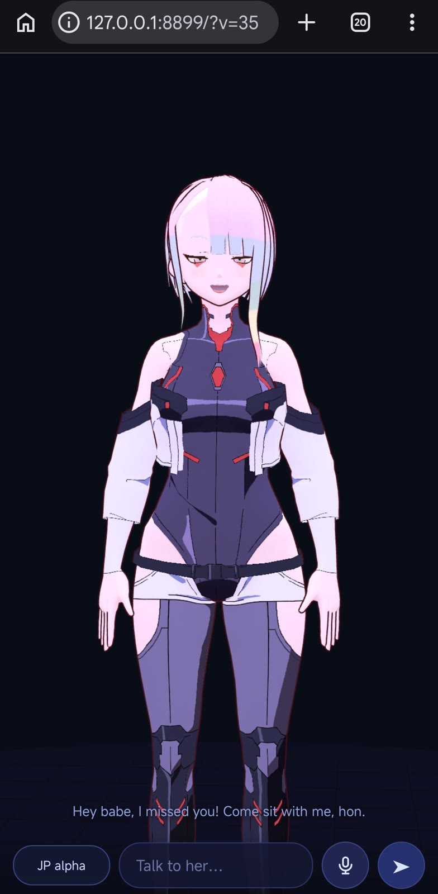

# Lucy — AI girlfriend for mobile

*For nerds and the pleasantly unhinged. You need a VRM rig, a Mixamo export, a compiled
whisper, an espeak shared library and an LLM key. If that sentence sounded fun instead of
exhausting, you are exactly who this is for.*

Self-hosted 3D VRM avatar running in the phone browser. The character animates on her
own (idle, walk, blinking, gaze), lip-syncs to synthesized speech, and answers through
an LLM that also drives her face and gestures with inline tags.

No build step. Python standard library server, three.js + @pixiv/three-vrm on the client.



## Features

- Mixamo animation retargeted onto any humanoid VRM (VRM 0.x and 1.0)
- Autonomous behaviour: idle, walking, greeting, nodding, looking at the camera
- Lip sync from the real audio waveform (RMS + zero-crossing), no phoneme data needed
- LLM replies carry `{joy}`, `{sad}`, `{wave}`, `{look:left}` … tags that are stripped
  from the audio and triggered on the matching word
- Voice output: local Kokoro-82M (offline), or edge-tts / Fish Audio / ElevenLabs /
  Qwen / Gemini
- Voice input: browser speech recognition, or local whisper.cpp as fallback

## Requirements

- Python 3.11+
- A humanoid VRM model placed at `lucy.vrm`
- A Mixamo animation set placed at `anim/Xbot.glb`
- `ffmpeg` (only for speech recognition from non 16 kHz audio)

## Install

```bash
git clone https://github.com/<you>/lucy-ai-girlfriend-mobile.git
cd lucy-ai-girlfriend-mobile
pip install edge-tts          # free voices, no key
cp llm.example.json llm.json  # then edit it (see below)
./start.sh                    # serves http://127.0.0.1:8899/
```

Put your own assets in place:

```
lucy.vrm          your VRM avatar
anim/Xbot.glb     Mixamo X Bot export with clips: idle, walk, agree, headShake, sad_pose
```

`./stop.sh` stops the server. The port is the first argument: `./start.sh 8080`.

## Configuration

Everything lives in `llm.json` (ignored by git). `llm.example.json` is the template.

### LLM provider — pick one

| provider | `base` | `key` |
| --- | --- | --- |
| `openai` | `https://api.openai.com/v1` | OpenAI key |
| `openai` (compatible) | any `/v1` endpoint | provider key |
| `anthropic` | `https://api.anthropic.com` | Anthropic key |
| `gemini` | `https://generativelanguage.googleapis.com` | Google AI Studio key |
| `ollama` | `http://127.0.0.1:11434` | empty string |
| `piwi` | `https://api.piwiai.com` | piwi key |

Local, no key, no network:

```json
{ "provider": "ollama", "base": "http://127.0.0.1:11434", "model": "llama3.1", "key": "" }
```

The `system` field holds the character prompt. Keep it short: it is sent on every turn.
Tags the model may use: `{joy} {smile} {sad} {angry} {surprised} {calm} {neutral}`
`{blink} {wave} {nod} {shake} {look:camera|left|right|up|down} {closer} {back} {walk}`.

### Voice — `tts` block

```json
"tts": { "engine": "edge", "edge_voice": "en-US-AriaNeural", "voice": "jf_alpha",
         "lang": "en-us", "fallback": "edge" }
```

| engine | cost | notes |
| --- | --- | --- |
| `kokoro` | free, offline | `voice` is a Kokoro voice (`jf_alpha`, `af_heart`, …), needs the model files |
| `edge` | free, no key | `edge_voice` any Azure neural voice name |
| `fish` | paid | `key` + optional `reference_id` |
| `eleven` | paid | `key` |
| `qwen` | paid | `key` (DashScope) |
| `gemini` | Google key | `key` |

`fallback` is tried automatically when the main engine fails.

### Local voice (offline, optional)

```bash
pip install kokoro-onnx numpy onnxruntime
mkdir -p kokoro && cd kokoro
curl -LO https://github.com/thewh1teagle/kokoro-onnx/releases/download/model-files-v1.0/kokoro-v1.0.onnx
curl -LO https://github.com/thewh1teagle/kokoro-onnx/releases/download/model-files-v1.0/voices-v1.0.bin
cd ..
pkg install espeak        # Termux; elsewhere install espeak-ng
```

`kokoro_local.py` talks to `libespeak-ng.so` directly through ctypes, so it does not need
the `phonemizer` package (which is broken on Android). Override paths with
`ESPEAK_LIB`, `ESPEAK_DATA`, `KOKORO_MODEL`, `KOKORO_VOICES`.

### Local speech recognition (optional)

```bash
git clone --depth 1 https://github.com/ggerganov/whisper.cpp
cmake -S whisper.cpp -B wbuild -DCMAKE_BUILD_TYPE=Release -DGGML_OPENMP=OFF
cmake --build wbuild -j4
cp wbuild/bin/whisper-cli .
curl -LO https://huggingface.co/ggerganov/whisper.cpp/resolve/main/ggml-base-q5_1.bin
```

If the browser supports the Web Speech API, that is used first; otherwise the page records
audio, resamples it to 16 kHz and posts it to `/api/stt`. Microphone access requires
`http://127.0.0.1` or HTTPS.

## API

| route | purpose |
| --- | --- |
| `GET /ping` | health check, returns `pong` |
| `POST /api/chat` | `{"messages":[{"role":"user","content":"..."}]}` → `{"text":"..."}` |
| `GET /api/tts?text=…&engine=…&voice=…` | audio (mp3 or wav), cached on disk |
| `POST /api/stt?lang=auto` | raw WAV body → `{"text":"..."}` |

## Files

```
serve.py          HTTP server and API routes
index.html        viewer, animation brain, chat, lip sync
retarget.js       Mixamo to VRM retargeting (world space deltas to local bones)
llm.py            LLM client, multi provider
tts.py            TTS registry (kokoro, edge, fish, eleven, qwen, gemini)
kokoro_local.py   Kokoro-82M on device through libespeak-ng
```

## License

Code: MIT. The VRM model, animations and voice samples are not included and are not
covered by this license; use assets you have the rights to.
